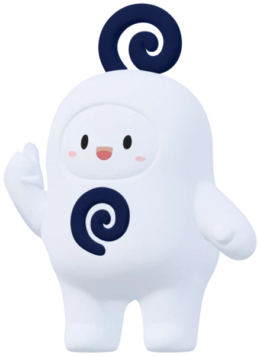
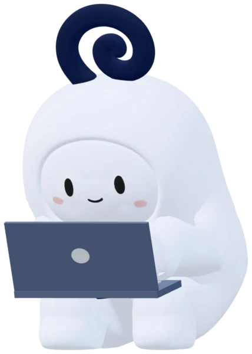
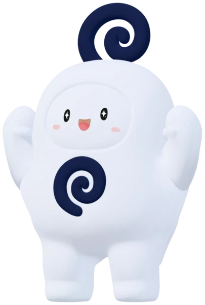
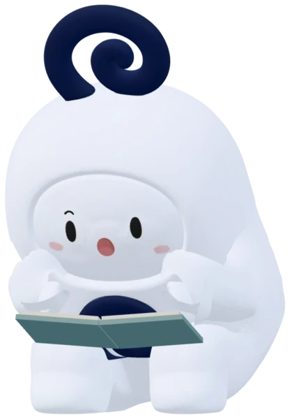

# 도름이 모습 기준

도름이를 그림·포스터·카드뉴스·영상에 넣을 때는 도름스(dorms.school)에 나오는 모습 그대로 씁니다.
기준은 이 저장소의 V60 승인 모델이고, 도름스와 쫑알이 같은 모델을 씁니다.

| 손 흔들기 | 노트북 코딩 | 환호 | 책 읽기 |
|---|---|---|---|
|  |  |  |  |

위 그림은 도름스 사이트의 렌더러(`motion-runtime.ts`)로 승인 동작과 표정을 그대로 찍은 것입니다.

## 지킬 모습

| 자리 | 기준 |
|---|---|
| 몸 | 흰색에 가까운 연한 회색, 둥근 머리와 몸이 한 덩어리, 짧은 팔다리 |
| 얼굴 | 얼굴 창 안의 작은 점 눈, 작은 입, 옅은 볼 홍조. 눈이 얼굴 창을 넘을 만큼 커지지 않는다 |
| 소용돌이 | 머리 위와 배에 하나씩, 진한 남색 |
| 질감 | 매끈한 3D. 도름스 화면과 같은 조명과 색 |

## 그림을 만들 때

- 이 모델을 렌더한 그림을 씁니다. 그냥 서 있는 모습보다 상황에 맞는 승인 동작(코딩·책 읽기·환호·손 흔들기 등)과 승인 표정을 골라 찍습니다.
- 이미지 생성 AI로 도름이를 새로 그리지 않습니다. 생성 그림은 눈이 커지고 몸이 굵어지며 소용돌이가 밝은 파랑으로 바뀌어, 도름스의 도름이와 다른 캐릭터가 됩니다.
- 소품이나 옷이 필요하면 모델에 입힌 상태로 렌더합니다(도름스 상점 아이템과 같은 방식).
- 배경은 자유롭게 둬도 됩니다. 도름이 자체의 비율과 색은 바꾸지 않습니다.

## 권리

도름이 © 아인T, CC BY-NC 4.0. 자세한 조건은 [`LICENSE-ASSETS.md`](../LICENSE-ASSETS.md)를 따릅니다.
